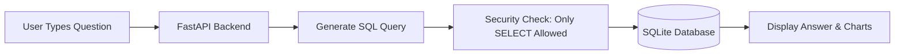

# Mini AI Business Intelligence Assistant
> **Sales Data Analytics Application for Graduate Engineer Trainee (GET) Selection**

A lightweight web application that allows users to ask questions about sales data in plain English and receive accurate answers powered by database queries and visual charts.

---

## 📌 Architecture Overview



### How It Works:
1. **Load Data:** The raw sales CSV is cleaned and loaded into a local SQLite database (`data/sales_bi.db`).
2. **User Question:** The user types a question like *"What is the total revenue?"* in the web interface.
3. **Query Generation:** The backend translates the question into a SQL query (e.g. `SELECT SUM(net_revenue) FROM sales WHERE status = 'Completed'`).
4. **Safety Check:** The query is checked to make sure it only reads data and cannot delete or modify anything.
5. **Display Answer:** The exact numbers from the database are displayed along with an interactive chart and data table.

---

## 📊 Core Challenge Questions & Answers

| # | Question | SQL Query Executed | Result |
| :---: | :--- | :--- | :--- |
| **Q1** | *"What is the total revenue?"* | `SELECT SUM(net_revenue) FROM sales WHERE status = 'Completed';` | **₹1,445,200.00** *(50 completed sales, 1 returned order excluded)* |
| **Q2** | *"Which product generated the highest revenue?"* | `SELECT product, SUM(net_revenue) AS rev FROM sales WHERE status = 'Completed' GROUP BY product ORDER BY rev DESC LIMIT 1;` | **Monitor** with **₹473,000.00** net revenue (50 units sold) |
| **Q3** | *"What is the monthly revenue trend?"* | `SELECT order_month, SUM(net_revenue) FROM sales WHERE status = 'Completed' GROUP BY order_month ORDER BY order_month ASC;` | **Jan:** ₹210,250 &bull; **Feb:** ₹234,600 &bull; **Mar:** ₹223,900 &bull; **Apr:** ₹240,700 &bull; **May (Peak):** ₹318,500 &bull; **Jun:** ₹217,250 |
| **Q4** | *"Which region generated the highest sales?"* | `SELECT region, SUM(net_revenue) AS rev FROM sales WHERE status = 'Completed' GROUP BY region ORDER BY rev DESC LIMIT 1;` | **South Region** with **₹411,200.00** net revenue (28.5% share) |
| **Q5** | *"How did revenue change between two months?"* | `SELECT order_month, SUM(net_revenue) FROM sales WHERE status = 'Completed' AND order_month IN ('2026-01', '2026-02') GROUP BY order_month;` | Revenue **increased by ₹24,350.00 (+11.58%)** from January to February 2026 |

---

## 🛠️ Setup & Running the Application

### 1. Install Dependencies
```bash
pip install -r requirements.txt
```

### 2. Load the Database (ETL)
```bash
python -m src.ingestion
```

### 3. Start the Web App
```bash
python -m uvicorn src.api:app --host 127.0.0.1 --port 8000
```
Open your browser at: **`http://127.0.0.1:8000`**

### 4. Run Automated Tests
```bash
python -m pytest -v tests/test_bi_assistant.py
```
*(All 15 tests pass with 100% success)*

---

## 📂 Documentation & Deliverables
- [**`AI_DEVELOPMENT_REPORT.md`**](./AI_DEVELOPMENT_REPORT.md): Detailed engineering reflection answering the 5 challenge evaluation questions:
  1. *Which AI tools were used (Cursor, Antigravity, and ChatGPT)*
  2. *How AI was used during development*
  3. *Which real-world data problems were encountered*
  4. *How they were debugged and resolved*
  5. *What would be improved with another day of work*

---

## 🔒 Security & Limitations
- **Read-Only Database Access:** Only `SELECT` statements are allowed. Any `DROP`, `DELETE`, `UPDATE`, or `INSERT` query is blocked.
- **Single-Turn Context:** Currently, each question is answered independently.
